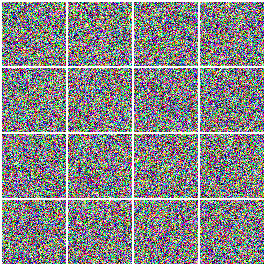
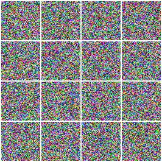
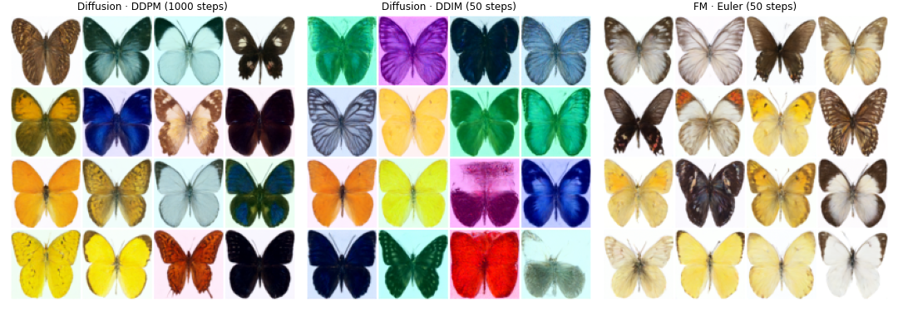
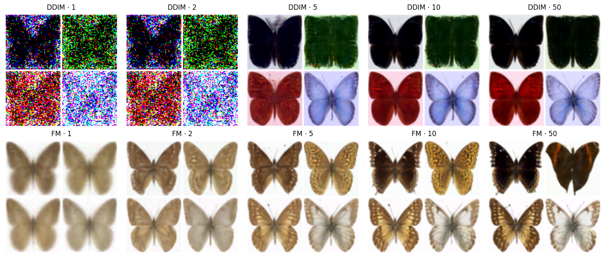

# Diffusion models vs flow matching

From-scratch implementations of **denoising diffusion** (DDPM / DDIM) and **flow matching**
(including optimal-transport pairing), compared side by side with the same networks, the
same data and the same training budget: first on 2D toy distributions, where the paths can
be seen, then on colour images.

| | Diffusion | Flow matching |
|---|---|---|
| Noise ↔ data | reverse of a noising **SDE** | **ODE** along (nearly) straight paths |
| Network predicts | noise ε (≈ score ∇ log pₜ) | velocity v = x₁ − x₀ |
| Sampling | DDPM (1000 stochastic steps) or DDIM (deterministic, ~50) | Euler / RK2, 10–50 steps |
| Maths | stochastic calculus, reverse-time SDEs | ODEs, optimal transport |

## Notebooks

| Notebook | Contents | Runs on |
|---|---|---|
| [`01_toy_2d.ipynb`](notebooks/01_toy_2d.ipynb) | Paths noise → data, quality vs number of steps, straightness of trajectories (DDPM, DDIM, FM, OT-FM) | CPU, a few minutes |
| [`02_butterflies.ipynb`](notebooks/02_butterflies.ipynb) | Same comparison on ~1000 colour butterfly images (🤗 `huggan/smithsonian_butterflies_subset`): samples, few-step generation, denoising GIFs, noise-space interpolation | Colab T4, ~1.5 h per model |

## Results on butterflies (64×64, same U-Net, 8000 training steps each)

<table>
<tr><th>Flow matching · 50 Euler steps</th><th>Diffusion · 1000 DDPM steps</th></tr>
<tr><td></td><td></td></tr>
</table>



- **Sample quality.** Flow matching with 50 steps reproduces the natural colours and white
  backgrounds of the data. Diffusion gets close with 1000 stochastic DDPM steps, but with
  deterministic DDIM (50 steps) the same network drifts to tinted backgrounds and saturated
  colours: with ε-prediction, errors in the first, almost pure-noise steps are amplified by
  1/√ᾱₜ and an ODE sampler cannot correct them afterwards.
- **Few steps.** Flow matching gives a (blurry) butterfly in a single step and is nearly
  converged after 5–10; DDIM needs at least 5 steps and fails at 1–2.



## Code

```
src/dfm/
├── diffusion.py       DDPM forward process, ε-prediction loss, DDPM and DDIM samplers
├── flow_matching.py   conditional flow matching loss, minibatch OT pairing, Euler / midpoint ODE solvers
├── models.py          time-conditioned MLP (2D) and 🤗 diffusers UNet2DModel wrapper (images)
├── train.py           one training loop for both methods (AdamW, one-cycle LR, EMA)
├── data.py            2D toy distributions and the butterflies dataset from the 🤗 Hub
└── viz.py             scatter plots, trajectories, image grids and GIFs
```

Both methods share the interface `model(x, t)` with `t ∈ [0, 1]`; only the regression
target changes, which keeps the comparison fair.

## Setup

```
pip install -e .
jupyter notebook notebooks/
```

On Colab, the first cell of `02_butterflies.ipynb` installs the package from this repository.

## References

- Ho, Jain & Abbeel (2020). *Denoising Diffusion Probabilistic Models.*
- Song et al. (2021). *Score-Based Generative Modeling through Stochastic Differential Equations.*
- Song, Meng & Ermon (2021). *Denoising Diffusion Implicit Models.*
- Nichol & Dhariwal (2021). *Improved Denoising Diffusion Probabilistic Models.*
- Lipman et al. (2023). *Flow Matching for Generative Modeling.*
- Liu, Gong & Liu (2023). *Flow Straight and Fast: Learning to Generate and Transfer Data with Rectified Flow.*
- Tong et al. (2023). *Improving and Generalizing Flow-Based Generative Models with Minibatch Optimal Transport.*
